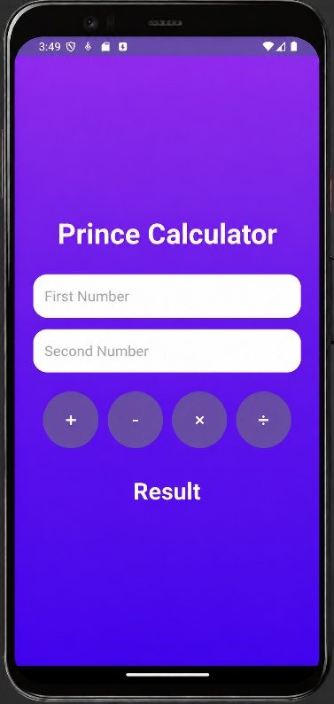
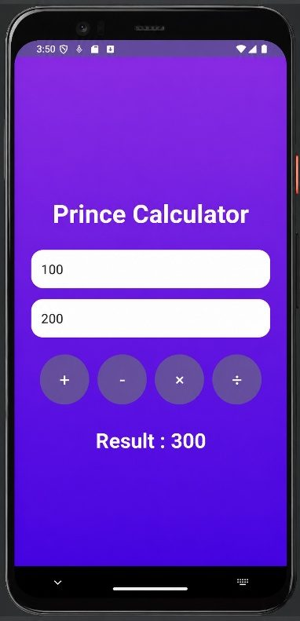
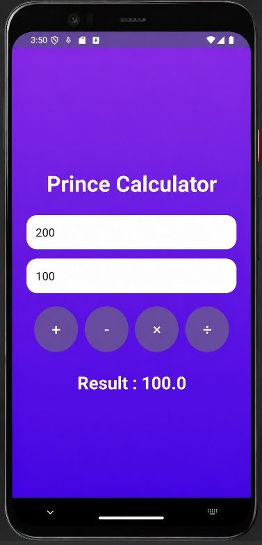
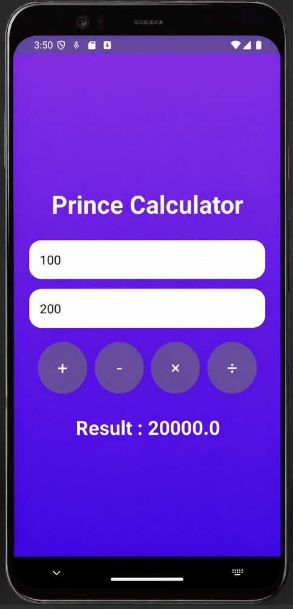
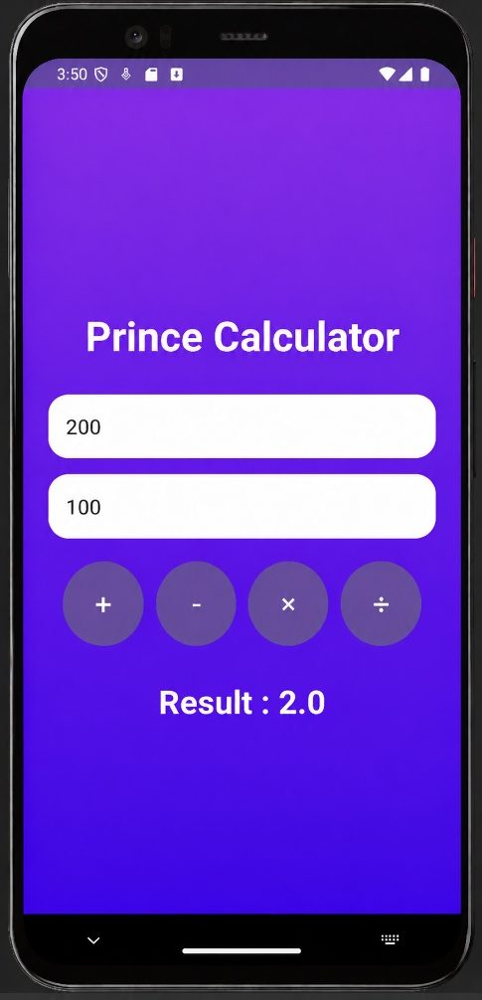

# Practical 2: Simple Calculator

**Aim:** Write an Android Program to Implement a Simple Calculator.

**Platform:** Android (Java, XML)

## Files

- `app/src/main/java/com/example/calculator_127/MainActivity.java`
- `app/src/main/res/drawable/bg_gradient.xml`
- `app/src/main/res/drawable/button_bg.xml`
- `app/src/main/res/drawable/edit_bg.xml`
- `app/src/main/res/layout/activity_main.xml`
- `app/src/main/res/values/strings.xml`

Copy the files into an Android Studio project at the same paths (match the package name shown in the folder path).

## Output

 
 
 
 
 
