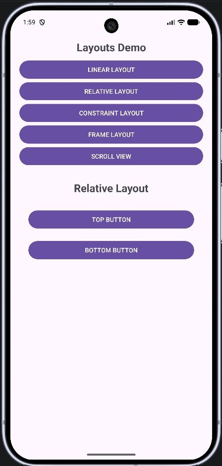
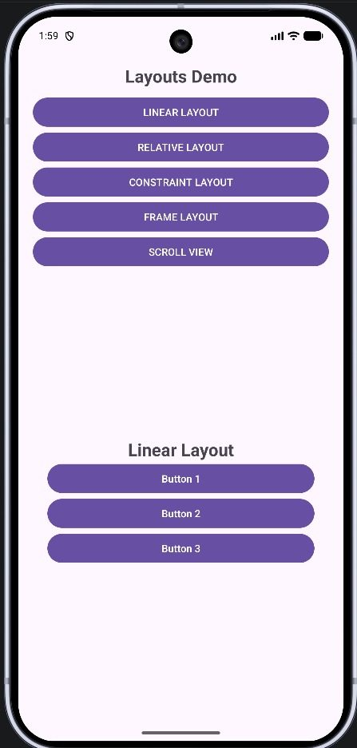
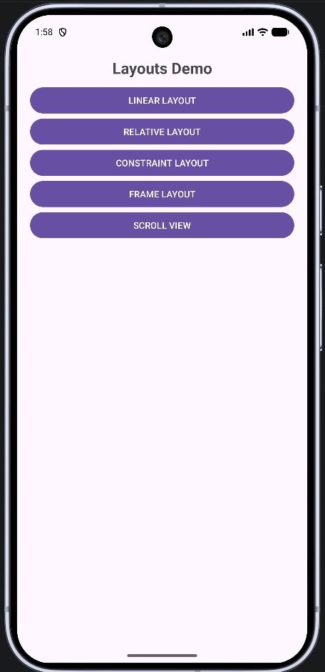

# Practical 3: Different Layouts

**Aim:** Write an Android Program to Demonstrate Different Layouts.

**Platform:** Android (Java, XML)

## Files

- `app/src/main/java/com/example/layoutprogram/MainActivity.java`
- `app/src/main/res/layout/activity_main.xml`
- `app/src/main/res/layout/layout_constraint.xml`
- `app/src/main/res/layout/layout_frame.xml`
- `app/src/main/res/layout/layout_linear.xml`
- `app/src/main/res/layout/layout_relative.xml`
- `app/src/main/res/layout/layout_scroll.xml`

Copy the files into an Android Studio project at the same paths (match the package name shown in the folder path).

## Output

 
 
 
