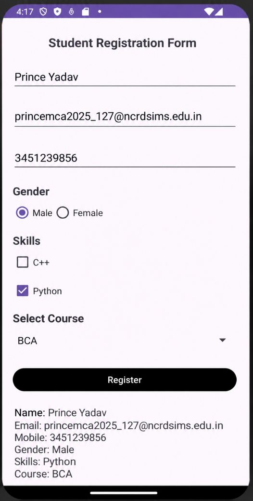

# Practical 4: Registration Form (UI Controls)

**Aim:** Write an Android Program to Design a Registration Form Using Various UI Controls.

**Platform:** Android (Java, XML)

## Files

- `app/src/main/java/com/example/studentform/MainActivity.java`
- `app/src/main/res/layout/activity_main.xml`

Copy the files into an Android Studio project at the same paths (match the package name shown in the folder path).

## Output

 
