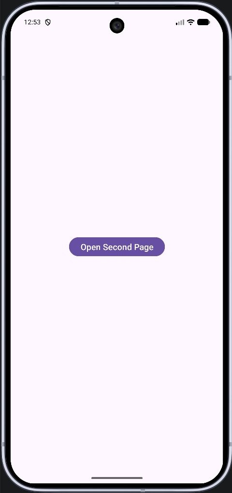
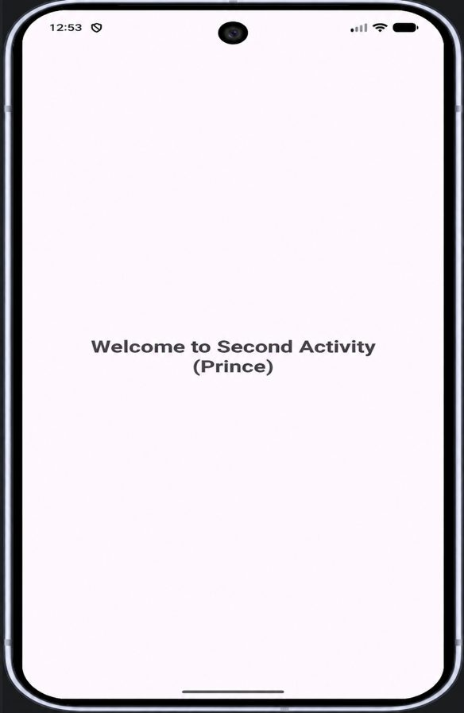
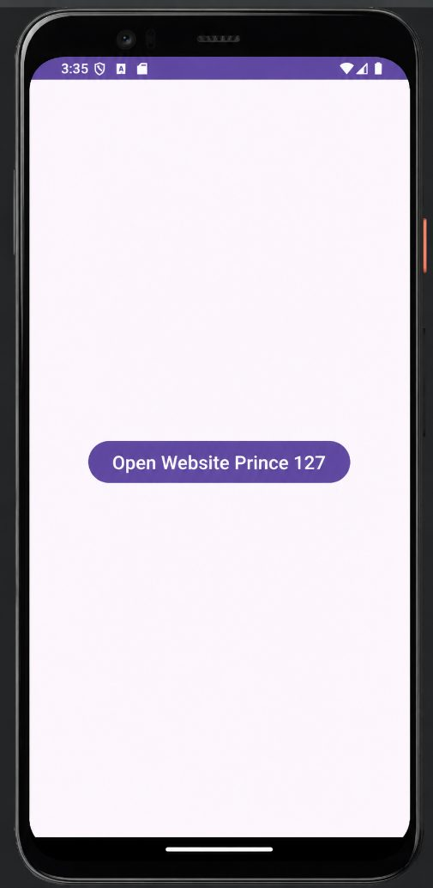
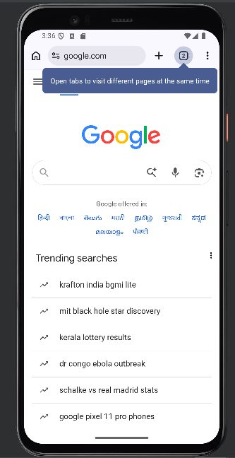

# Practical 5: Explicit and Implicit Intents

**Aim:** Write an Android Program to Demonstrate Explicit and Implicit Intents.

**Platform:** Android (Java, XML)

## Files

- `5a-Explicit-Intent/app/src/main/AndroidManifest.snippet.xml`
- `5a-Explicit-Intent/app/src/main/java/com/example/intentdemo/MainActivity.java`
- `5a-Explicit-Intent/app/src/main/java/com/example/intentdemo/SecondActivity.java`
- `5a-Explicit-Intent/app/src/main/res/layout/activity_main.xml`
- `5a-Explicit-Intent/app/src/main/res/layout/activity_second.xml`
- `5b-Implicit-Intent/app/src/main/java/com/example/intent_127/MainActivity.java`
- `5b-Implicit-Intent/app/src/main/res/layout/activity_main.xml`

Copy the files into an Android Studio project at the same paths (match the package name shown in the folder path).

## Setup notes

- Register `SecondActivity` in `AndroidManifest.xml` (see `5a-Explicit-Intent/app/src/main/AndroidManifest.snippet.xml`).

## Corrections made while preparing this repo

- `SecondActivity.java` (sub-app 5a-Explicit-Intent): code indentation was lost in the journal and has been re-formatted.

## Output

**5a-Explicit-Intent**

 
 

**5b-Implicit-Intent**

 
 

