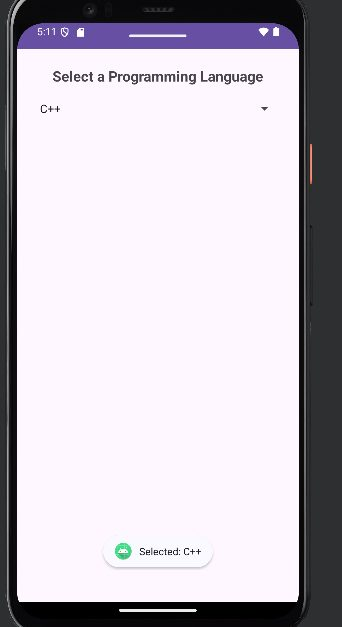
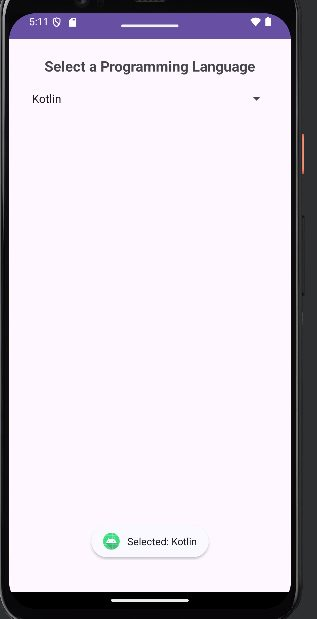

# Practical 7: Spinner

**Aim:** Write an Android Program to Demonstrate the Use of a Spinner.

**Platform:** Android (Java, XML)

## Files

- `app/src/main/java/com/example/spinnerdemo/MainActivity.java`
- `app/src/main/res/layout/activity_main.xml`
- `app/src/main/res/values/strings.xml`

Copy the files into an Android Studio project at the same paths (match the package name shown in the folder path).

## Output

 
 
