# Practical 8: Alert Dialogs

**Aim:** Write an Android Program to Demonstrate Notifications and Alert Dialogs.

**Platform:** Android (Java, XML)

## Files

- `8a-Alert-Box/app/src/main/java/com/example/alertboxapp/MainActivity.java`
- `8a-Alert-Box/app/src/main/res/layout/activity_main.xml`
- `8b-Confirmation-Alert/app/src/main/java/com/example/confirmationalertbox/MainActivity.java`
- `8b-Confirmation-Alert/app/src/main/res/layout/activity_main.xml`
- `8c-Validate-Name/app/src/main/java/com/example/validatename/MainActivity.java`
- `8c-Validate-Name/app/src/main/res/layout/activity_main.xml`
- `8d-Divide-Validation/app/src/main/java/com/example/dividevalidation/MainActivity.java`
- `8d-Divide-Validation/app/src/main/res/layout/activity_main.xml`
- `8e-Delete-Confirmation/app/src/main/java/com/example/alertbox_prince_five/MainActivity.java`
- `8e-Delete-Confirmation/app/src/main/res/layout/activity_main.xml`
- `8f-Exit-Confirmation/app/src/main/java/com/example/exitconfirmation/MainActivity.java`
- `8f-Exit-Confirmation/app/src/main/res/layout/activity_main.xml`

Copy the files into an Android Studio project at the same paths (match the package name shown in the folder path).

## Setup notes

- The journal aim mentions notifications, but all six examples use `AlertDialog`; no notification code is in the journal.

## Corrections made while preparing this repo

- 8d (Divide validation): added the missing closing `}` of the `MainActivity` class, which was cut off in the journal.

## Output

**8a-Alert-Box**

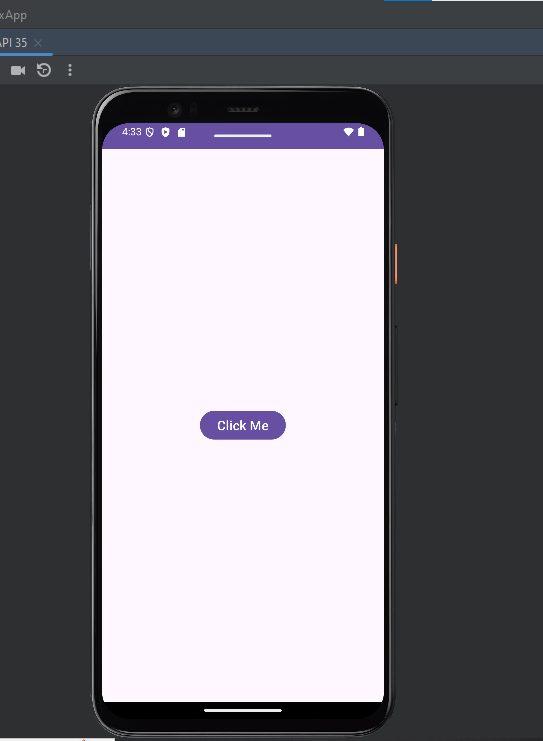 
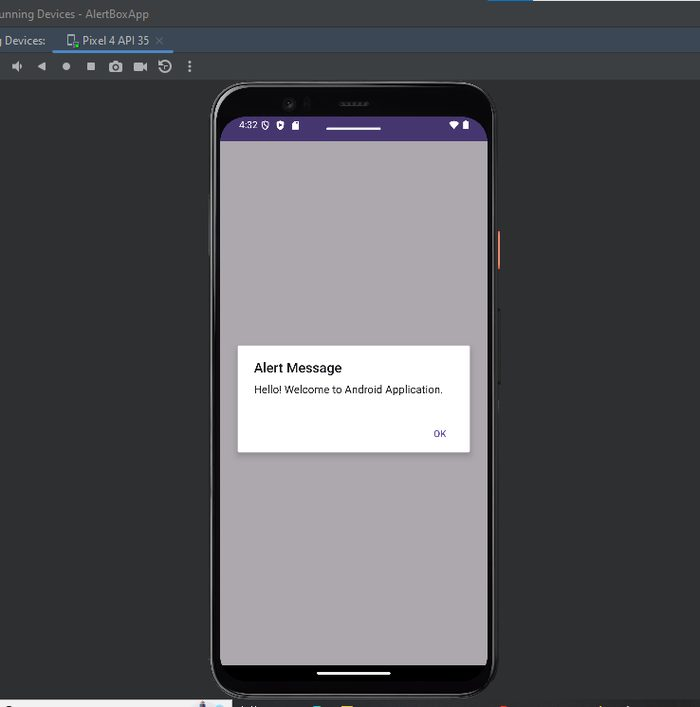 

**8b-Confirmation-Alert**

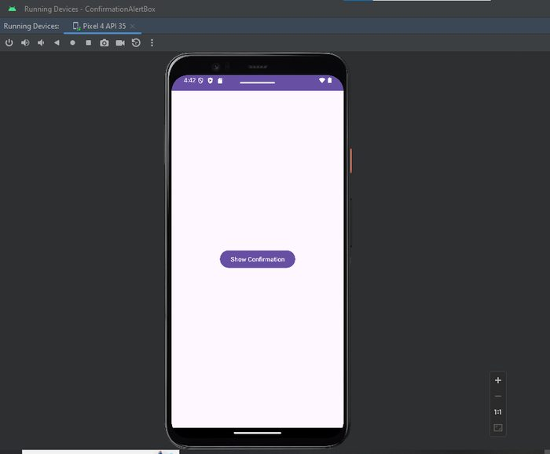 
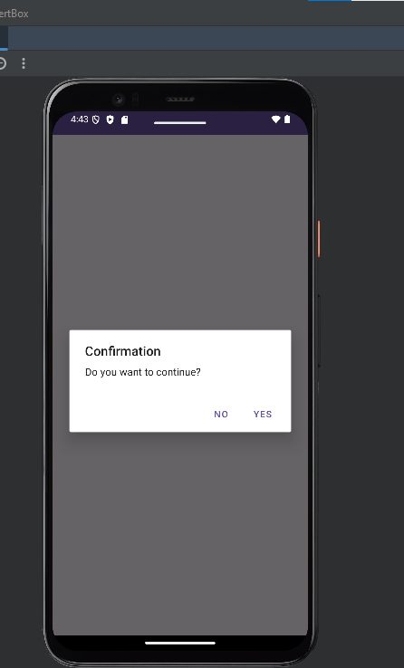 

**8c-Validate-Name**

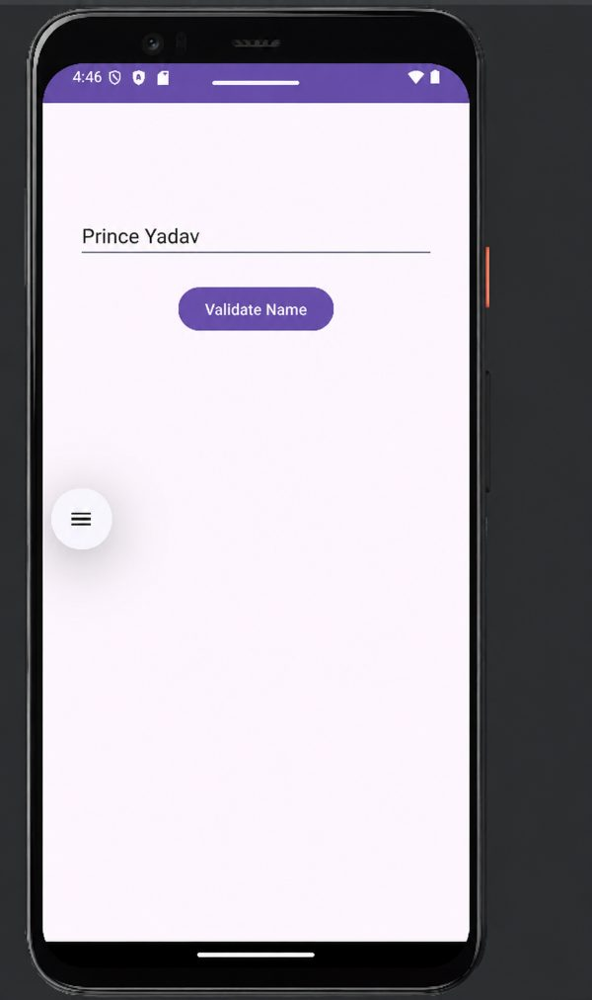 
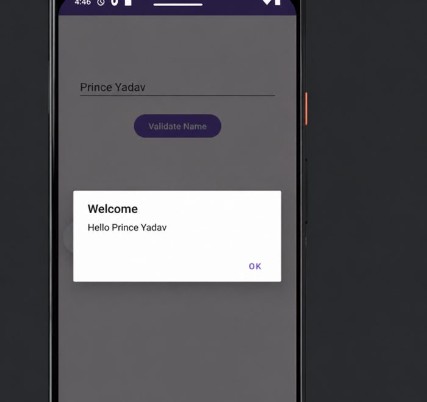 

**8d-Divide-Validation**

 
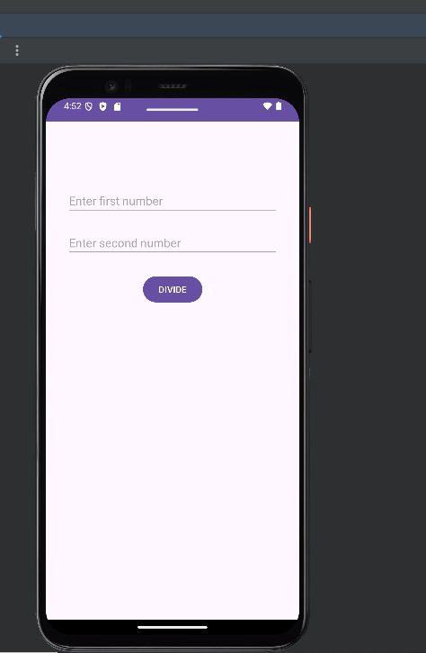 
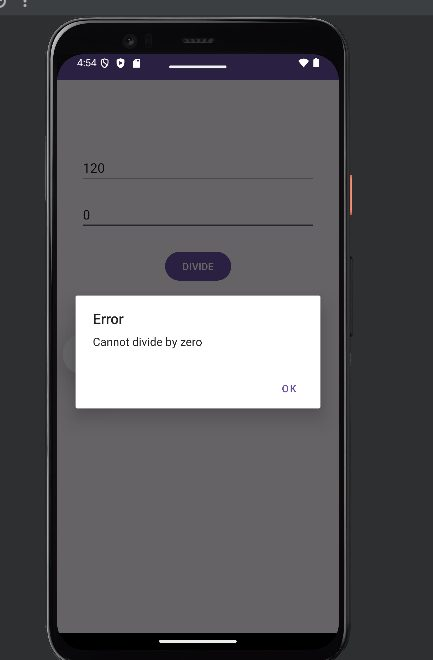 

**8e-Delete-Confirmation**

 
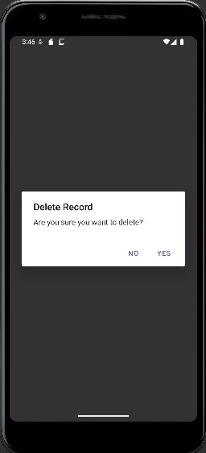 

**8f-Exit-Confirmation**

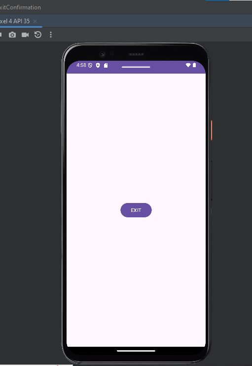 
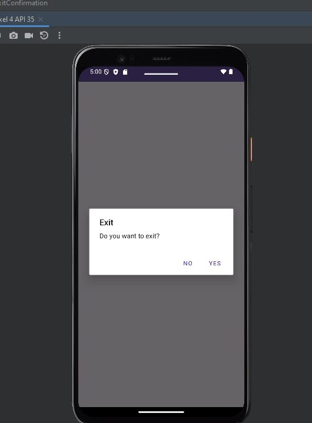 
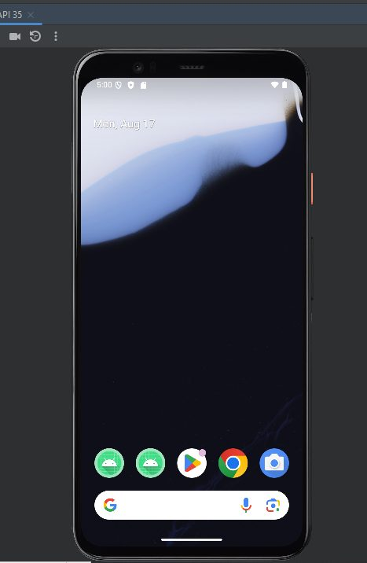 

