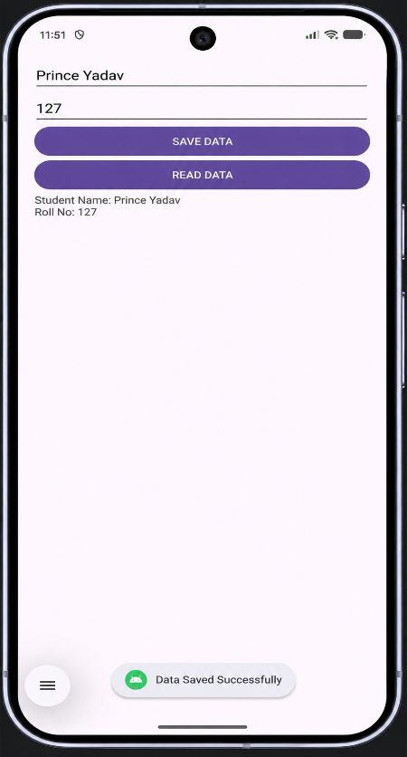
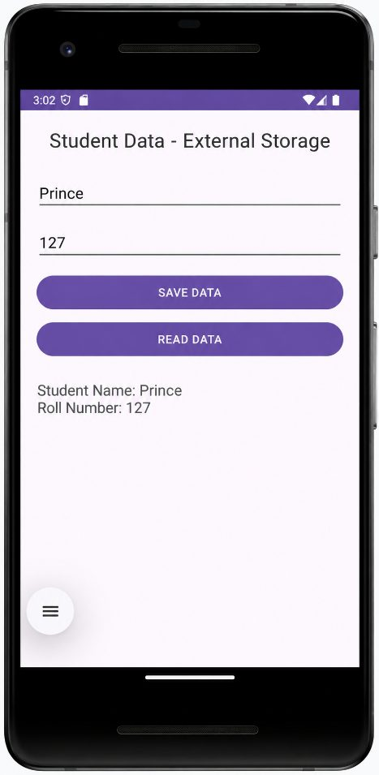
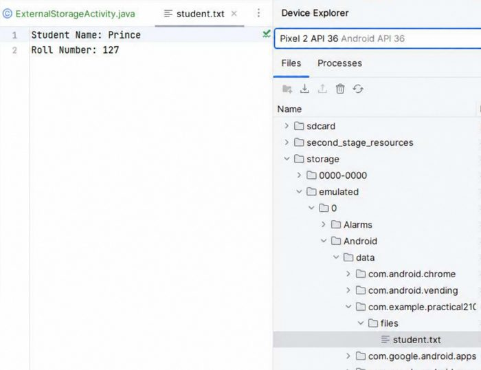

# Practical 9: Internal and External File Storage

**Aim:** Write an Android Program to Demonstrate Internal and External File Storage.

**Platform:** Android (Java, XML)

## Files

- `9a-Internal-Storage/app/src/main/java/com/example/filehandling127/MainActivity.java`
- `9a-Internal-Storage/app/src/main/res/layout/activity_main.xml`
- `9b-External-Storage/app/src/main/java/com/example/practical127/ExternalStorageActivity.java`
- `9b-External-Storage/app/src/main/res/layout/external_storage.xml`

Copy the files into an Android Studio project at the same paths (match the package name shown in the folder path).

## Setup notes

- 9b uses `getExternalFilesDir(null)` (app-specific external storage), so no storage permission is required.

## Corrections made while preparing this repo

- `ExternalStorageActivity.java` (sub-app 9b-External-Storage): code indentation was lost in the journal and has been re-formatted.

## Output

**9a-Internal-Storage**

 

**9b-External-Storage**

 
 

