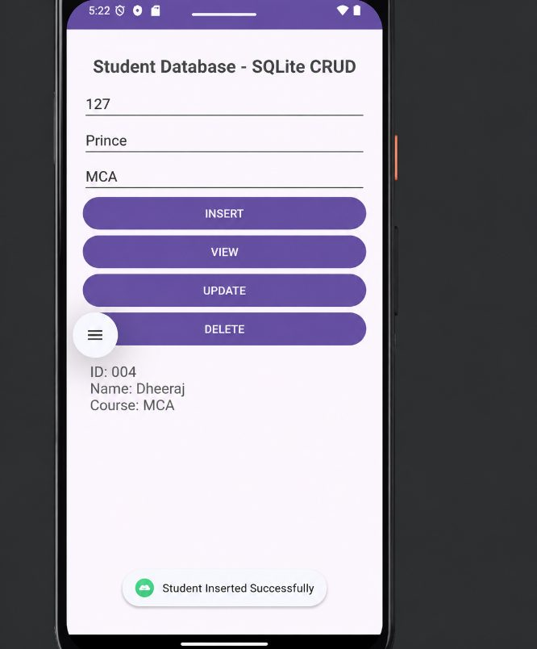
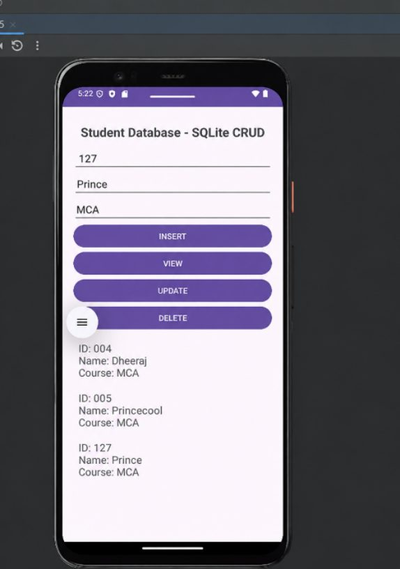
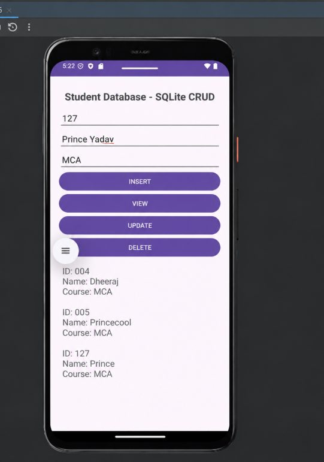
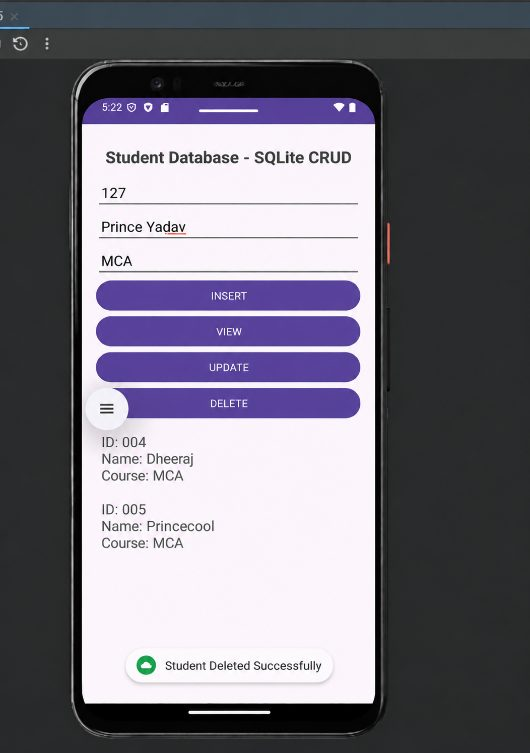

# Practical 11: SQLite CRUD

**Aim:** Write an Android Program to Perform CRUD Operations Using SQLite.

**Platform:** Android (Java, XML)

## Files

- `app/src/main/java/com/example/sqlitecrud/MainActivity.java`
- `app/src/main/res/layout/activity_main.xml`

Copy the files into an Android Studio project at the same paths (match the package name shown in the folder path).

## Setup notes

- **`DatabaseHelper` is not included.** `MainActivity` uses a `DatabaseHelper` class (`insertStudent`, `getAllStudents`, ...), but its code is not in the journal. Copy `DatabaseHelper.java` (a `SQLiteOpenHelper` subclass) from your Android Studio project into `app/src/main/java/com/example/sqlitecrud/` before uploading.

## Output

 
 
 
 
