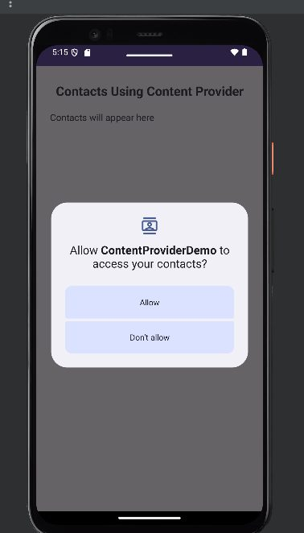
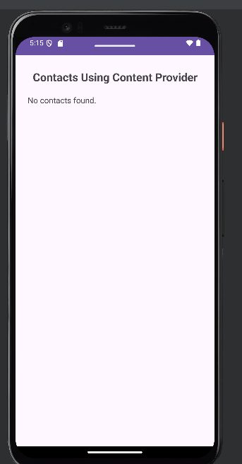

# Practical 12: Content Providers

**Aim:** Write an Android Program to Access Data Using Content Providers.

**Platform:** Android (Java, XML)

## Files

- `app/src/main/AndroidManifest.xml`
- `app/src/main/java/com/example/contentproviderdemo/MainActivity.java`
- `app/src/main/res/layout/activity_main.xml`

Copy the files into an Android Studio project at the same paths (match the package name shown in the folder path).

## Setup notes

- Needs the `READ_CONTACTS` permission (included in `AndroidManifest.xml`) and granting it on the device.

## Corrections made while preparing this repo

- The layout XML was pasted directly under the Java code without a heading; it has been saved as `activity_main.xml`.

## Output

 
 
