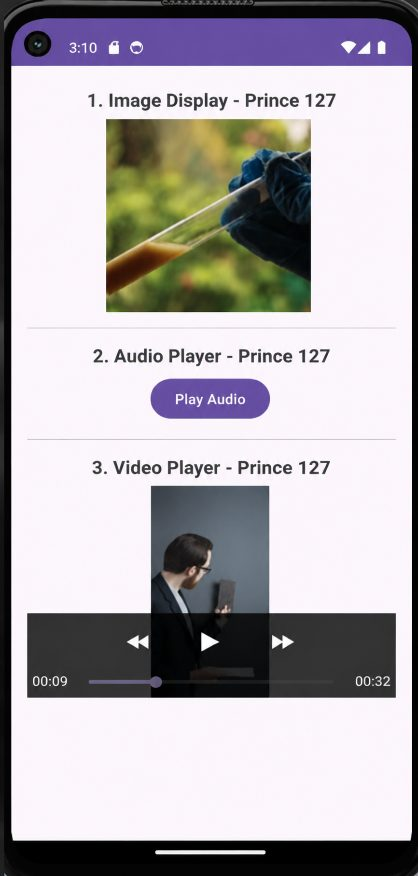

# Practical 14: Images, Audio and Video

**Aim:** Write an Android Program to Work with Images, Audio, and Video.

**Platform:** Android (Java, XML)

## Files

- `app/src/main/java/com/example/imagevideo/MainActivity.java`
- `app/src/main/res/layout/activity_main.xml`

Copy the files into an Android Studio project at the same paths (match the package name shown in the folder path).

## Setup notes

- Needs your own media files: `res/drawable/sample_image`, `res/raw/sample_audio`, `res/raw/sample_video`. They are not in the repo.

## Corrections made while preparing this repo

- Added the missing semicolon after `findViewById(R.id.videoView)`.
- `MainActivity.java` (main): code indentation was lost in the journal and has been re-formatted.

## Output

 
