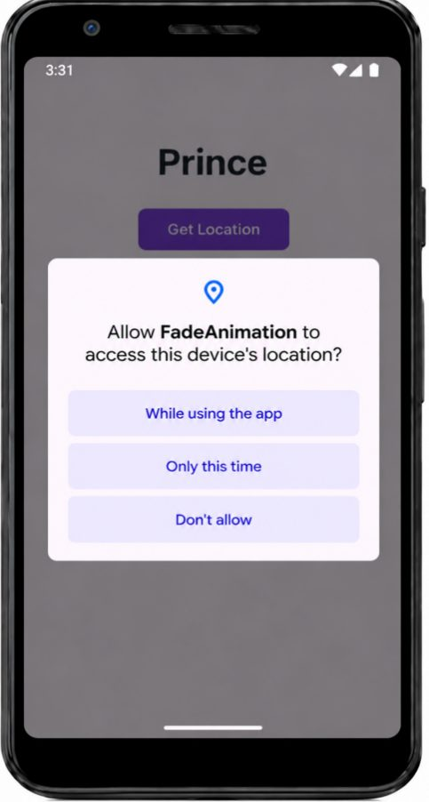
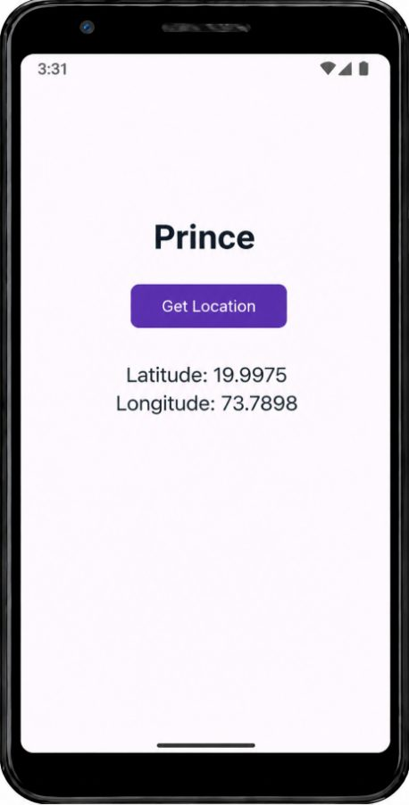

# Practical 15: Location Data

**Aim:** Write an Android Program to Retrieve and Display Location Data.

**Platform:** Android (Java, XML)

## Files

- `app/src/main/AndroidManifest.snippet.xml`
- `app/src/main/java/com/example/fadeanimation/MainActivity.java`
- `app/src/main/res/layout/activity_main.xml`

Copy the files into an Android Studio project at the same paths (match the package name shown in the folder path).

## Setup notes

- Add the permission from `AndroidManifest.snippet.xml` inside `<manifest>`.
- Package name is `com.example.fadeanimation` (the project was reused); rename via *Refactor > Rename* if you like.
- Test on a real device or an emulator with a location set and GPS enabled.

## Corrections made while preparing this repo

- Completed the truncated `requestLocationUpdates(...)` call. The journal had `GPS_PROVIDER,}`, which does not compile; it now ends with `0, 0, listener);`.

## Output

 
 
