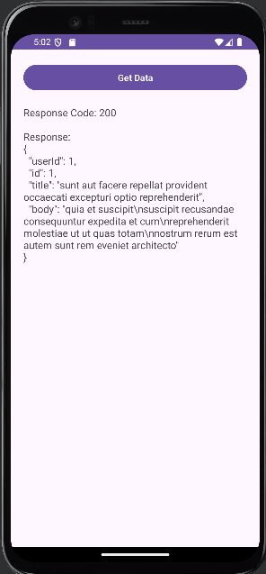
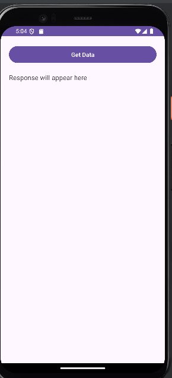

# Practical 16: REST API using OkHttp

**Aim:** Write an Android Program to Access REST APIs Using OkHttp.

**Platform:** Android (Java, XML)

## Files

- `app/src/main/java/com/example/okhttpdemo/MainActivity.java`
- `app/src/main/res/layout/activity_main.xml`

Copy the files into an Android Studio project at the same paths (match the package name shown in the folder path).

## Setup notes

- Add the dependency `implementation("com.squareup.okhttp3:okhttp:4.12.0")` in `app/build.gradle` and `<uses-permission android:name="android.permission.INTERNET" />` in the manifest.

## Output

 
 
