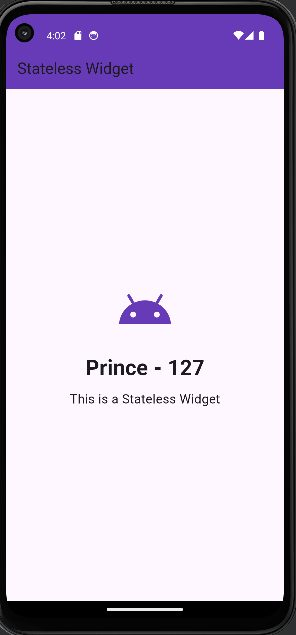

# Practical 18: Flutter: Stateless Widgets

**Aim:** Write a Flutter Program to Demonstrate Stateless Widgets.

**Platform:** Flutter (Dart)

## Files

- `lib/main.dart`

Replace `lib/main.dart` in a new Flutter project (`flutter create .`), then run `flutter run`.

## Output

 
