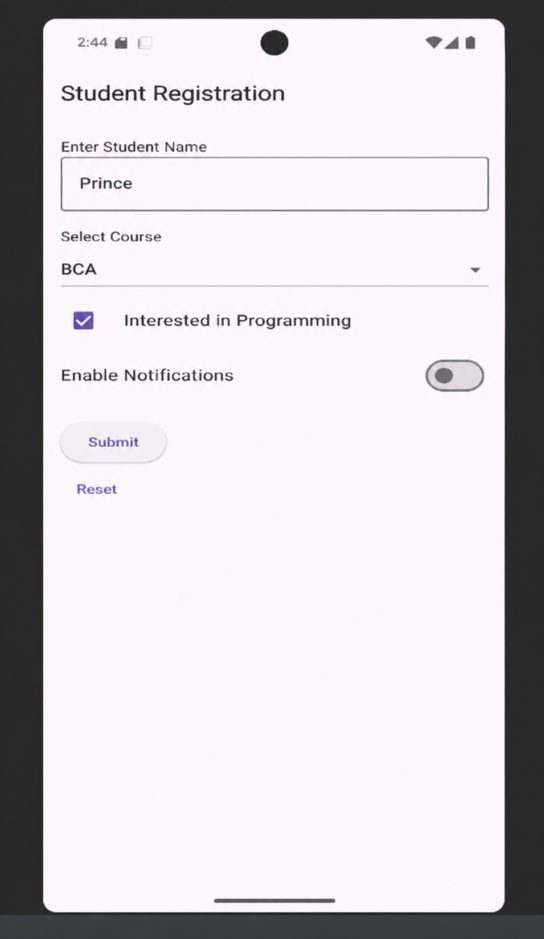
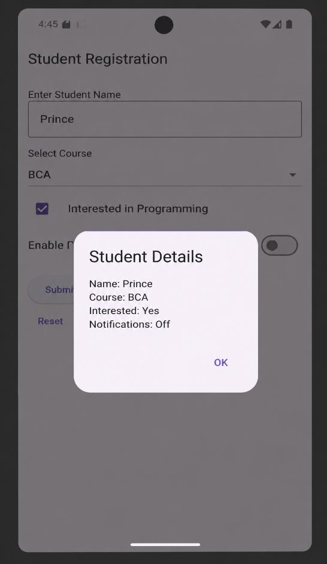

# Practical 20: Flutter: Registration Form

**Aim:** Write a Flutter Program to Design a Registration Form Using TextField, Checkbox, Buttons, Dropdown, Switch, and Other UI Controls.

**Platform:** Flutter (Dart)

## Files

- `lib/main.dart`

Replace `lib/main.dart` in a new Flutter project (`flutter create .`), then run `flutter run`.

## Output

 
 
