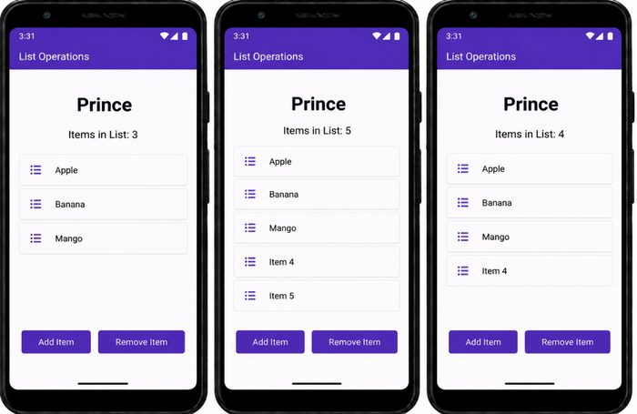

# Practical 21: Flutter: List Operations

**Aim:** Write a Flutter Program to Demonstrate List Operations.

**Platform:** Flutter (Dart)

## Files

- `lib/main.dart`

Replace `lib/main.dart` in a new Flutter project (`flutter create .`), then run `flutter run`.

## Output

 
