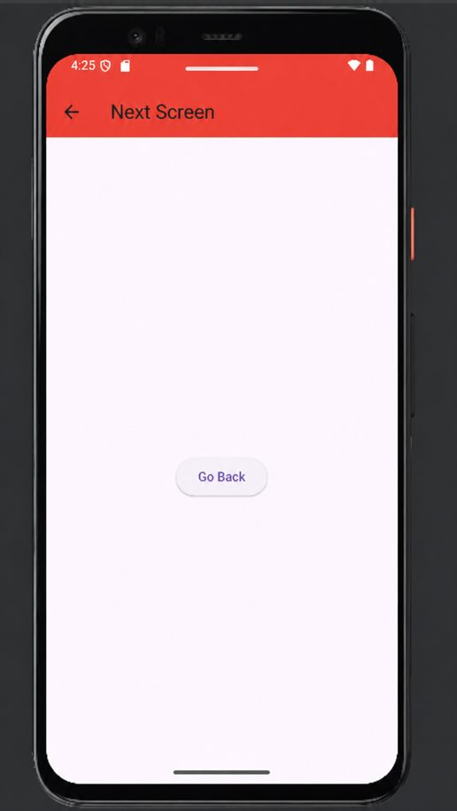
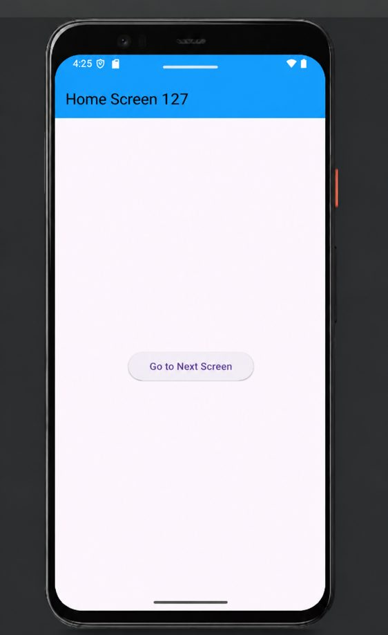

# Practical 22: Flutter: Navigation Between Screens

**Aim:** Write a Flutter Program to Implement Navigation Between Screens.

**Platform:** Flutter (Dart)

## Files

- `android/app/src/main/AndroidManifest.xml`
- `lib/main.dart`

Replace `lib/main.dart` in a new Flutter project (`flutter create .`), then run `flutter run`.

## Setup notes

- Copy `android/app/src/main/AndroidManifest.xml` into your Flutter project only if you need the same settings; it is the default Flutter manifest with the INTERNET permission.

## Corrections made while preparing this repo

- Fixed a missing opening quote in `Text(Next Screen')`.
- The button navigated to `NextScreen()`, but the class in the journal is `SecondScreen`; the reference now matches the class name.

## Output

 
 
